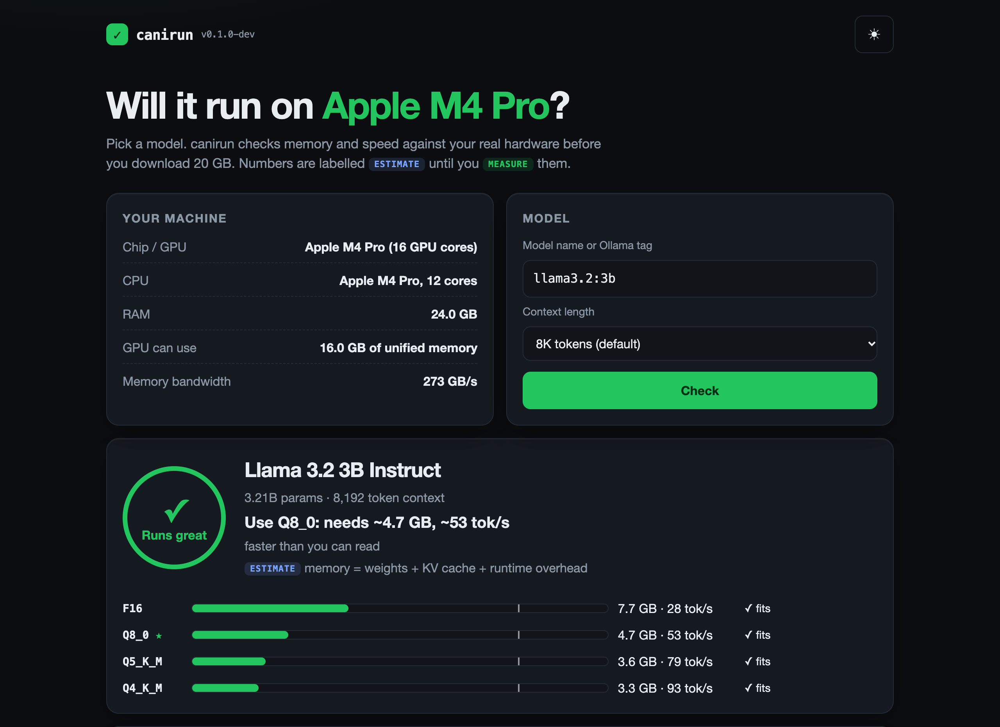
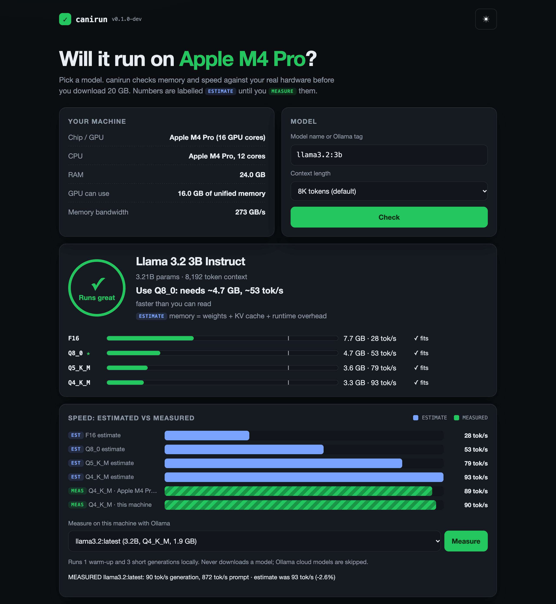

# canirun: stop downloading 40 GB models that won't run. Know in one second.

**One command tells you whether an LLM fits on *your* machine, which quantization to use, and how fast it will be, before you download anything. Then it measures, so you can check the estimate.**

Real hardware detection (Apple Silicon, NVIDIA, AMD; macOS, Linux, Windows), honest math, and every number labelled **ESTIMATE** or **MEASURED**. One static binary. Nothing leaves your machine.

| Before you download: "will Llama 3.3 70B run?" | After: measured on this Mac, next to the estimate |
|---|---|
|  |  |

<!-- TODO: 20-second demo GIF (terminal: canirun qwen3:14b → canirun bench → canirun ui) -->
> 🎬 **TODO:** short demo GIF. The screenshots above are real captures of `canirun ui` on an M4 Pro (24 GB).

## Quick start

From a clone (works today, needs Go 1.22+):

```sh
go run ./cmd/canirun ui          # local web UI on 127.0.0.1
go run ./cmd/canirun qwen3:14b   # or straight in the terminal
```

One-line installs, **available once the first GitHub release is published** (configs are in the repo and tested locally):

```sh
curl -fsSL https://raw.githubusercontent.com/Kavin-bm/canirun/main/install.sh | sh   # macOS / Linux, verifies SHA-256
brew install Kavin-bm/tap/canirun                                                     # Homebrew
go install github.com/Kavin-bm/canirun/cmd/canirun@latest                             # Go
```

Windows: download the `.zip` from Releases (coming with the first release).

## What it looks like

```text
$ canirun qwen3:14b
ESTIMATE (not measured): Qwen3 14B (14.8B params)
Machine: Apple M4 Pro, 24.0 GB unified memory (GPU can use ~16.0 GB)
Context: 8192 tokens

QUANT   NEEDS    SPEED (est.)  VERDICT
F16     30.7 GB  -             ❌ no
Q8_0    17.1 GB  ~11 tok/s     🟡 partial (~93% on GPU, rest on CPU)
Q5_K_M  12.0 GB  ~17 tok/s     ✅ fits
Q4_K_M  10.5 GB  ~20 tok/s     ✅ fits

Best pick: Q5_K_M - ✅ fits, needs ~12.0 GB, ~17 tok/s (comfortable reading speed).
```

```text
$ canirun bench llama3.2
MEASURED: llama3.2:latest (3.2B Q4_K_M) via ollama 0.21.2
  Generation:        88.8 tok/s (faster than you can read)
  Prompt processing: 858 tok/s
  On GPU:            100%
ESTIMATE for llama3.2-3b Q4_K_M on this machine: 92.6 tok/s (measured is -4%)
```

Thinking of buying hardware? Ask "what if":

```text
$ canirun llama3.3:70b --vram 48 --ram 64 --bw 936 --quant Q4_K_M
Machine: hypothetical 48 GB GPU, 48.0 GB VRAM + 64.0 GB RAM
Best pick: Q4_K_M - ✅ fits, needs ~44.9 GB, ~14 tok/s (comfortable reading speed).
```

## Commands

| Command | What it does |
|---|---|
| `canirun <model>` | ESTIMATE of memory and speed for F16, Q8_0, Q5_K_M, Q4_K_M with a verdict: **fits** (all in GPU / unified memory), **partial** (some layers on CPU, slower) or **no**. Flags: `--ctx`, `--quant`, `--ram`, `--vram`, `--bw`. |
| `canirun recommend` | Every catalog model that runs here, with the quant to use and estimated speed. |
| `canirun bench [model]` | MEASURES real speed with your local Ollama (1 warm-up + 3 runs) and compares with the estimate. `--save` writes a result file to share. Never downloads; skips Ollama cloud models. |
| `canirun bench <model> --gguf f.gguf` | MEASURES a GGUF file with llama.cpp's `llama-bench`. |
| `canirun ui` | Local web UI: hardware card, model picker, estimated vs measured chart, one-click benchmark with confirmation, shareable PNG result card. |
| `canirun hw` | Detected OS, CPU, RAM, GPU, usable GPU memory, memory bandwidth. |
| `canirun list` | The 50-model catalog in [`models/`](models/) (Llama, Qwen, Gemma, DeepSeek, Mistral, Phi, gpt-oss...). |
| `canirun mcp` | MCP server over stdio for coding agents. |
| `canirun validate [files]` | Check catalog and result YAML files before a PR. |

`<model>` can be a catalog id, an Ollama tag (`llama3.1:8b`, `qwen3:30b`, `deepseek-r1`) or a bare size (`13b`).

### For scripts and agents

Every command takes `--json`. Errors in JSON mode are `{"error": "...", "exit_code": N}`. Exit codes are stable:

| Code | Meaning |
|---|---|
| 0 | OK (for an estimate: the model runs here, fully or partly) |
| 1 | Error (detection, I/O) |
| 2 | Usage error (bad flag, unknown model) |
| 3 | The model will not fit on this machine |
| 4 | Benchmark runtime not available, or model not installed |

```sh
canirun qwen3:32b --json >/dev/null && ollama pull qwen3:32b   # only download if it fits
```

## How the estimate works

- **Memory** = weights (parameters × bits per weight: F16 16, Q8_0 8.5, Q5_K_M 5.69, Q4_K_M 4.85) + KV cache (2 × layers × KV heads × head dim × context × 2 bytes) + overhead (512 MB + 5% of weights).
- **Usable memory:** Apple Silicon GPU gets ~2/3 of RAM (3/4 above 36 GB, or your `iogpu.wired_limit_mb`); discrete GPUs get 95% of VRAM plus 70% of RAM for offload; CPU-only gets 70% of RAM.
- **Speed** = memory bandwidth × efficiency ÷ bytes read per token (active parameters, so mixture-of-experts models like Qwen3 30B-A3B and gpt-oss are fast). Bandwidth comes from spec sheets for ~80 chips; efficiency (0.66) is calibrated from real runs: Llama 3.2 3B Q4_K_M on an M4 Pro measured 89–94 tok/s with Ollama and llama-bench against an estimate of 93. If your chip is not in the table, the speed is marked as assumed.
- **Known limits:** speed is for short context (long chats are slower); prompt-processing speed is only measured, not estimated; sliding-window models (Gemma 2/3, gpt-oss) need less KV cache than estimated. CPU-only efficiency is still an assumption: [send a result](CONTRIBUTING.md) to calibrate it.

## Safety promises

- **Read-only.** canirun only reads hardware info (`sysctl`, `system_profiler`, `/proc`, `/sys`, `nvidia-smi`, `lspci`, PowerShell CIM). It never changes a setting.
- **Never downloads a model.** `bench` only uses models you already pulled, and refuses Ollama cloud models because they would send prompts off your machine.
- **Local only.** No telemetry, no accounts, no cloud. The UI binds to `127.0.0.1`, rejects other hosts and cross-site requests, and makes zero external requests (strict CSP).
- **Honest labels.** ESTIMATE until measured. MEASURED numbers come from a real run, yours or a community result with the chip named.
- **One binary, zero dependencies.** Pure Go standard library.

## Paste this into your coding agent

```text
Use canirun (https://github.com/Kavin-bm/canirun) to check which local LLMs my
computer can run. Run `canirun hw --json` and `canirun recommend --json`, then
explain the 3-5 best options in plain words: what each is good for, memory
needed, and speed (30+ tok/s faster than reading, 10-30 comfortable, under 4
painfully slow). Say which numbers are ESTIMATE vs MEASURED. Ask me before
running `canirun bench` (it uses the GPU for up to a minute) and never
download a model without my explicit yes.
```

The full prompt for non-technical users is in [PROMPT.md](PROMPT.md). Prefer tools? `claude mcp add canirun -- canirun mcp` gives Claude Code (and other MCP clients) the same functions.

## Roadmap

- [x] Memory + speed estimate, 50-model catalog, what-if hardware flags
- [x] Measured benchmarks with Ollama and llama.cpp, community results
- [x] Local web UI with shareable result card
- [x] MCP server, `--json` everywhere, stable exit codes
- [ ] First release: binaries, Homebrew tap, curl installer live (configs ready)
- [ ] Demo GIF
- [ ] Any Hugging Face model by repo name (read `config.json`, cache locally)
- [ ] Prompt-processing speed estimate from GPU compute
- [ ] Sliding-window and quantized KV cache in the memory math
- [ ] MLX runtime adapter
- [ ] Verified on real Windows and Linux GPU machines (parsers are unit-tested; help wanted)

## Contributing

The catalog and the measured results are plain YAML, so the community can grow them by PR:

- **Share your speed:** `canirun bench <model> --save`, then PR the file into `models/results/`.
- **Add a model:** copy a file in `models/`, fill in five numbers from `config.json`, `canirun validate`, PR.
- **Add your GPU's bandwidth** in `internal/hw/bandwidth.go`.

See [CONTRIBUTING.md](CONTRIBUTING.md) and [GOOD_FIRST_ISSUES.md](GOOD_FIRST_ISSUES.md).

### Contributors

<!-- TODO: add contrib.rocks image once the repo is public -->
Thanks to everyone who adds a model or a benchmark. Your name goes here.

## License

MIT, see [LICENSE](LICENSE). Security issues: see [SECURITY.md](SECURITY.md).
